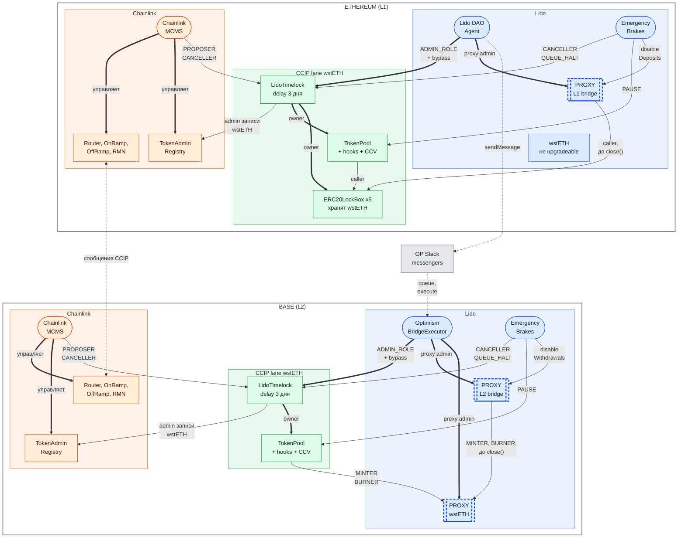
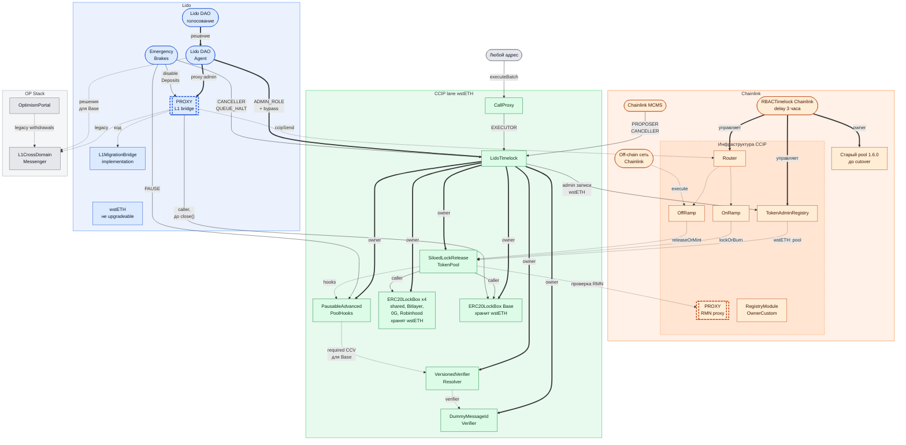
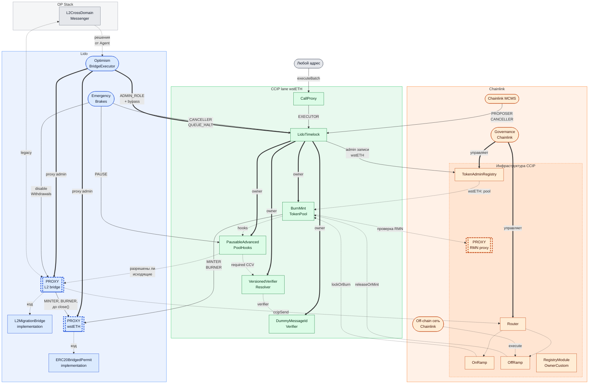
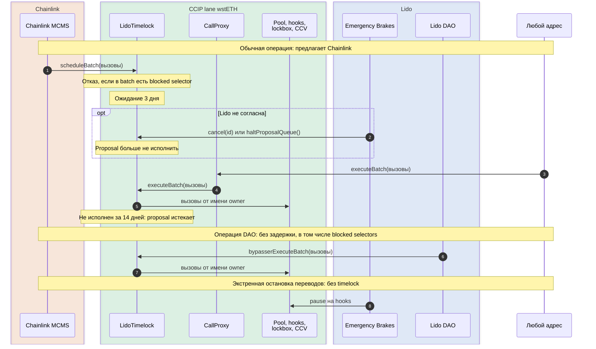
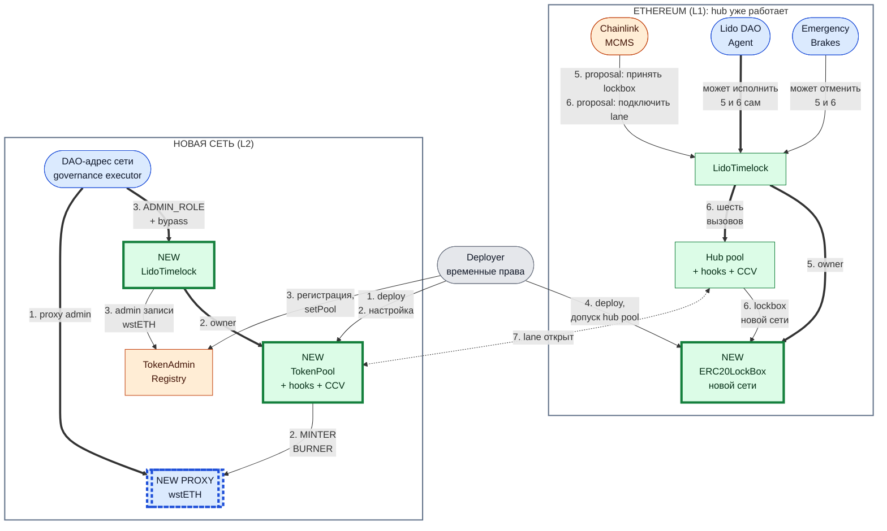
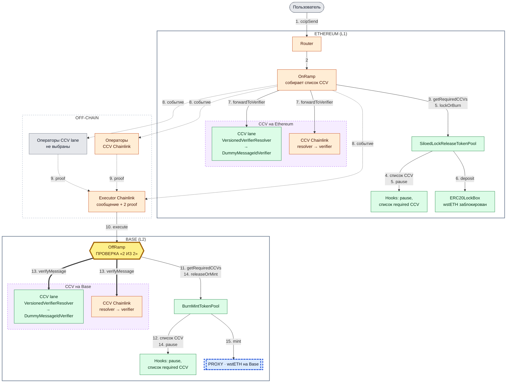

# Архитектура wstETH на CCIP: компоненты и кто чем управляет

Дата: 2026-11-11. Источники перечислены в [разделе 11](#11-источники-и-когда-обновлять).

| Диаграмма | Вопрос, на который она отвечает |
| --- | --- |
| [1. Обзор](#1-обзор-кто-чем-управляет) | Кто чем управляет, где L1 и L2, что принадлежит Lido и что Chainlink |
| [2. Все элементы](#2-все-элементы) | Какие контракты и акторы есть в каждой сети и как они связаны |
| [7. Операция управления](#7-как-проходит-операция-управления) | Как меняется конфигурация и кто может остановить изменение |
| [8. Подключение новой сети](#8-как-подключается-новая-сеть) | Что развёртывается и кто что делает, чтобы открыть новый lane |
| [9. Путь перевода](#9-путь-перевода-ethereum--base) | Через какие контракты проходит перевод wstETH, где участвует CCV и где проверяется «2 из 2» |

## Что здесь описано

Целевое устройство пары **Ethereum ↔ Base** после DAO-голосования по миграции Base и до
`close()` на обоих legacy bridge: то состояние, которое проверяет state-mate в
[`targets/wsteth-base-migration-mainnet`](targets/wsteth-base-migration-mainnet/README.md).
Остальные сети отличаются от этой пары деталями, они собраны в [разделе 10](#10-чего-на-схемах-нет).

Статус этого устройства:

- **mainnet**: зелёные контракты не развернуты, и legacy bridge с token на Base ещё не обновлены. Существуют Agent,
  `OptimismBridgeExecutor`, wstETH, оба legacy bridge и инфраструктура Chainlink. Переход отрепетирован на forks
  Ethereum и Base; адреса Emergency Brakes и Chainlink MCMS на новых контрактах в репетиции подставные.
- **Sepolia**: развернуто 2026-11-04 по той же модели управления
  ([отчёт](orchestration/wsteth-ccip/docs/SEPOLIA-FRESH-DEPLOY-2026-11-04.md)), с отличиями из раздела 10.

Схемы показывают задуманную структуру. Они не доказывают состояние сети: фактические адреса и
значения берутся из chain records, state-mate и [`ledger.json`](ledger.json).

## 1. Обзор: кто чем управляет

### Как читать схемы

Стрелка всегда направлена от того, кто имеет право, к тому, над чем это право действует.
Расположение блоков выше или ниже ничего не означает. Обозначения одинаковы на всех схемах.

| Обозначение | Значение |
| --- | --- |
| Синий блок | Сторона Lido: DAO, её multisig и контракты, которые меняет только DAO |
| Зелёный блок | Контракт CCIP lane для wstETH: владеет Lido через `LidoTimelock`, обычные изменения предлагает Chainlink MCMS |
| Оранжевый блок | Система Chainlink: Lido её не меняет |
| Серый блок | Ни Lido, ни Chainlink: OP Stack, deployer, любой адрес |
| Скруглённый блок | Актор, который держит роли: DAO, multisig, governance executor |
| Прямоугольник | Контракт. У синих и зелёных прямоугольников upgrade невозможен; для оранжевых и серых upgradeability не показана |
| Блок `PROXY` с толстой пунктирной рамкой | Proxy: implementation можно заменить |
| Блок `NEW` с толстой рамкой | Появляется при подключении новой сети (только раздел 8) |
| Толстая стрелка | Полная власть: `owner()`, `ADMIN_ROLE`, proxy admin, управление системой Chainlink |
| Тонкая стрелка | Ограниченная роль: названа на стрелке |
| Пунктирная стрелка | Связь без власти: вызов, ссылка в конфигурации, implementation, доставка между сетями |

На обзорной схеме несколько блоков объединяют по нескольку контрактов или адресов. По отдельности они показаны в разделе 2.

| Блок на обзорной схеме | Что в нём |
| --- | --- |
| `TokenPool + hooks + CCV`, Ethereum | `SiloedLockReleaseTokenPool`; `PausableAdvancedPoolHooks`; `VersionedVerifierResolver` и `DummyMessageIdVerifier`. Четыре контракта, owner каждого — `LidoTimelock`. Роль `PAUSE` действует на hooks |
| `TokenPool + hooks + CCV`, Base | `BurnMintTokenPool`; `PausableAdvancedPoolHooks`; `VersionedVerifierResolver` и `DummyMessageIdVerifier`. `MINTER_ROLE` и `BURNER_ROLE` на token держит pool |
| `LidoTimelock` | `LidoTimelock` и его `CallProxy`: готовый proposal исполняет любой адрес. Delay 3 дня, proposal истекает через 14 дней |
| `ERC20LockBox x5` | Общий lockbox для Monad и MegaETH и отдельные lockbox для Bitlayer, 0G, Robinhood и Base |
| `Chainlink MCMS` | Multisig Chainlink с ролями на `LidoTimelock` и governance Chainlink, которое управляет её инфраструктурой. Один ли это адрес, в репозитории не зафиксировано |
| `Router, OnRamp, OffRamp, RMN` | Общая инфраструктура CCIP в этой сети, включая RMN proxy |
| `OP Stack messengers` | `L1CrossDomainMessenger` на Ethereum и `L2CrossDomainMessenger` на Base |
| `proxy admin` | У Agent и `OptimismBridgeExecutor` на тех же контрактах есть и `DEFAULT_ADMIN_ROLE` |
| `admin записи wstETH` | `LidoTimelock` — administrator записи wstETH в `TokenAdminRegistry`: назначает pool |

## 2. Все элементы

Здесь каждый контракт и актор показан отдельным блоком. Схемы широкие: на GitHub удобнее открыть их через
кнопки масштаба в углу диаграммы.

### 2.1. Ethereum (L1)

### 2.2. Base (L2)

### 2.3. Адреса существующих контрактов mainnet

Адреса прочитаны из mainnet в даты, записанные в `target.json` (2026-10-21, 2026-10-26, 2026-10-30), и из API Chainlink.
Зелёные контракты в mainnet не развернуты, поэтому адресов у них нет.

| Элемент | Ethereum | Base |
| --- | --- | --- |
| DAO-адрес сети | Agent `0x3e40D73EB977Dc6a537aF587D48316feE66E9C8c` | `OptimismBridgeExecutor` `0x0E37599436974a25dDeEdF795C848d30Af46eaCF` |
| wstETH | `0x7f39C581F595B53c5cb19bD0b3f8dA6c935E2Ca0` | `0xc1CBa3fCea344f92D9239c08C0568f6F2F0ee452` |
| Legacy bridge (proxy) | `0x9de443AdC5A411E83F1878Ef24C3F52C61571e72` | `0xac9D11cD4D7eF6e54F14643a393F68Ca014287AB` |
| Emergency Brakes на legacy bridge | `0x73b047fe6337183A454c5217241D780a932777bD` | `0x0F9A0e7071B7B21bc7a8514DA2cd251bc1FF0725` |
| CrossDomainMessenger | `0x866E82a600A1414e583f7F13623F1aC5d58b0Afa` | `0x4200000000000000000000000000000000000007` |
| Router | `0x80226fc0Ee2b096224EeAc085Bb9a8cba1146f7D` | `0x881e3A65B4d4a04dD529061dd0071cf975F58bCD` |
| TokenAdminRegistry | `0xb22764f98dD05c789929716D677382Df22C05Cb6` | `0x6f6C373d09C07425BaAE72317863d7F6bb731e37` |
| RegistryModuleOwnerCustom | `0x4855174E9479E211337832E109E7721d43A4CA64` | `0xAFEd606Bd2CAb6983fC6F10167c98aaC2173D77f` |
| RMN proxy | `0x411dE17f12D1A34ecC7F45f49844626267c75e81` | `0xC842c69d54F83170C42C4d556B4F6B2ca53Dd3E8` |
| OnRamp 2.0.0 | `0xc3423F3FB30857D9C14717b119884b1B63d250b7` | не записан |
| OffRamp 2.0.0 | `0x408428bca0e24A25ac8baAc1b70f64AF257717c3` | не записан |
| RBACTimelock Chainlink | `0x44835bBBA9D40DEDa9b64858095EcFB2693c9449` | не записан |
| Старый pool wstETH 1.6.0 | `0xA586a732394A1AFfCF15b972cd47C936033C9FA7` | — |

На Ethereum кроме OffRamp 2.0.0 входящие сообщения принимают общий OffRamp 1.6.0 и старые OffRamp отдельных сетей;
они перечислены в [плане миграции hub](targets/wsteth-base-migration-mainnet/CHAINLINK_HUB_MIGRATION_FORK_PLAN.md).

## 3. Что значит «владеет»

За толстыми стрелками на схемах стоят пять разных прав. Они выдаются отдельно и держатся разными адресами.

| Право | Что позволяет | Кто держит |
| --- | --- | --- |
| `owner()` | Менять конфигурацию контракта | `LidoTimelock` на pool, hooks, lockbox, resolver, verifier |
| `ADMIN_ROLE` на `LidoTimelock` | Выдавать и отзывать роли timelock, менять delay и blocked selectors, исполнять batch немедленно через `bypasserExecuteBatch` | Agent на Ethereum; `OptimismBridgeExecutor` на Base |
| proxy admin | Заменить implementation | Agent на Ethereum; `OptimismBridgeExecutor` на Base |
| `DEFAULT_ADMIN_ROLE` | Выдавать и отзывать роли на token и legacy bridge | Agent на Ethereum; `OptimismBridgeExecutor` на Base |
| administrator записи в `TokenAdminRegistry` | Назначать pool для wstETH через `setPool` | `LidoTimelock` |

`TokenAdminRegistry` — контракт Chainlink. Lido управляет в нём только записью своего token.

## 4. Четыре зоны контроля

| Зона | Контракты | Кто меняет | Как |
| --- | --- | --- | --- |
| Только Lido | wstETH на Base; оба legacy bridge; их proxy | Lido DAO | Голосование → Agent; на Base дополнительно сообщение через OP Stack → `OptimismBridgeExecutor` |
| Lido владеет, Chainlink предлагает | `LidoTimelock`; pool; hooks; lockbox; resolver и verifier | Chainlink MCMS предлагает, Lido может остановить или сделать сам | `scheduleBatch` → 3 дня → исполнение любым адресом через `CallProxy`. Emergency Brakes: `cancel`, `haltProposalQueue`. DAO: `bypasserExecuteBatch` без задержки |
| Chainlink | Router; OnRamp; OffRamp; RMN proxy; `TokenAdminRegistry`; off-chain сеть доставки | Chainlink | Собственное governance Chainlink |
| OP Stack | `L1CrossDomainMessenger`; `L2CrossDomainMessenger` | Не Lido и не Chainlink | В репозитории не описано |

Что Chainlink MCMS **не может** провести через `LidoTimelock`: пять selectors заблокированы для proposals,
их исполняет только DAO через bypass.

- `transferOwnership(address)`
- `transferAdminRole(address,address)`
- `upgradeToAndCall(address,bytes)`
- `grantRole(bytes32,address)`
- `revokeRole(bytes32,address)`

Proposal исполняется от имени timelock, а timelock не держит ролей на самом себе, поэтому proposal не может
поменять роли timelock, delay или список blocked selectors.

Что Lido может сделать с частью Chainlink, не меняя её:

- остановить переводы: Emergency Brakes вызывает pause на hooks, сразу, без timelock;
- ограничить объём: rate limits на pool (по умолчанию 330 wstETH исходящих, 500 wstETH входящих за ~24 часа на lane);
- потребовать дополнительную проверку сообщений: список required CCV в hooks;
- отвязать pool от token: `setPool` в `TokenAdminRegistry` через timelock.

Снять pause может только owner hooks, то есть proposal через timelock или DAO через bypass.

## 5. Proxy и upgradeable

| Контракт | Сеть | Upgradeable | Кто меняет implementation |
| --- | --- | --- | --- |
| L1 bridge (`L1MigrationBridge`) | Ethereum | Да, `OssifiableProxy` | Agent |
| L2 bridge (`L2MigrationBridge`) | Base | Да, `OssifiableProxy` | `OptimismBridgeExecutor` |
| wstETH на Base (`ERC20BridgedPermit`) | Base | Да, `OssifiableProxy` | `OptimismBridgeExecutor` |
| wstETH на новом spoke (`ERC20BridgedPermit`) | новый L2 | Да, `TransparentUpgradeableProxy` + `ProxyAdmin` | DAO-адрес этой сети как owner `ProxyAdmin` |
| wstETH | Ethereum | Нет | — |
| `LidoTimelock`, `CallProxy` | обе | Нет | — |
| `SiloedLockReleaseTokenPool`, `BurnMintTokenPool` | Ethereum, Base | Нет | — |
| `PausableAdvancedPoolHooks`, `ERC20LockBox` | обе | Нет | — |
| `VersionedVerifierResolver`, `DummyMessageIdVerifier` | обе | Нет | — |
| RMN proxy | обе | Proxy Chainlink | Chainlink; в репозитории не проверяется |

Контракты CCIP lane заменяются новым деплоем и перенастройкой, а не upgrade. Точки замены:

- pool — `TokenAdminRegistry.setPool`;
- lockbox — `configureLockBoxes` на pool;
- required CCV — `applyCCVConfigUpdates` на hooks;
- verifier за resolver — `applyOutboundImplementationUpdates` и `applyInboundImplementationUpdates` на resolver.

`CallProxy` — не upgrade proxy: это исполнитель proposals, который пересылает любой вызов в свой timelock.

## 6. Акторы и роли

| Актор | Сеть | Что это | Роли |
| --- | --- | --- | --- |
| Lido DAO Agent `0x3e40D73EB977Dc6a537aF587D48316feE66E9C8c` | Ethereum | Адрес, от имени которого исполняются решения DAO | `ADMIN_ROLE` на `LidoTimelock`; proxy admin и `DEFAULT_ADMIN_ROLE` на L1 bridge; отправитель решений для Base |
| `OptimismBridgeExecutor` `0x0E37599436974a25dDeEdF795C848d30Af46eaCF` | Base | Исполнитель решений DAO на Base: принимает action sets только от Agent, delay 0, grace period 1 день, guardian отсутствует | `ADMIN_ROLE` на `LidoTimelock`; proxy admin и `DEFAULT_ADMIN_ROLE` на token и L2 bridge |
| Emergency Brakes | обе | Multisig Lido для быстрых остановок | На `LidoTimelock`: `CANCELLER_ROLE`, `PROPOSAL_QUEUE_HALT_ROLE`. На hooks: `CROSS_CHAIN_TRANSFERS_PAUSE_ROLE`. На legacy bridge: `disableDeposits` (Ethereum), `disableWithdrawals` (Base) |
| Chainlink MCMS | обе | Multisig Chainlink | На `LidoTimelock`: `PROPOSER_ROLE`, `CANCELLER_ROLE`. На hooks ролей нет |
| Chainlink governance | обе | MCMS и `RBACTimelock` Chainlink | Управляет инфраструктурой CCIP. На контрактах Lido ролей нет |
| Любой адрес | обе | — | Исполняет готовый proposal через `CallProxy`; вызывает `activate()` и `close()` на legacy bridge после срока |
| Deployer | обе | Ключ развёртывания | После передачи ролей не держит ничего |

Адреса Emergency Brakes на действующих legacy bridge прочитаны из mainnet 2026-10-26.
Кто будет держать роли Emergency Brakes и Chainlink MCMS на новых `LidoTimelock` и hooks в mainnet,
не зафиксировано: в target стоят подставные адреса.

Сегодня в mainnet `RBACTimelock` Chainlink — owner действующего pool 1.6.0 и administrator записи wstETH
в `TokenAdminRegistry` на Ethereum. После cutover запись wstETH указывает на новый pool, а её administrator — `LidoTimelock`.

## 7. Как проходит операция управления

Операция здесь — изменение конфигурации контрактов CCIP lane: rate limits, новый lane, набор required CCV,
замена verifier. Все такие изменения идут через `LidoTimelock` одной из трёх дорог.

| Дорога | Кто начинает | Задержка | Что можно провести | Кто может остановить |
| --- | --- | --- | --- | --- |
| Обычная | Chainlink MCMS: `scheduleBatch` | 3 дня; proposal истекает через 14 дней после постановки | Любые вызовы от имени owner, кроме пяти blocked selectors | Emergency Brakes или Chainlink MCMS: `cancel(id)`. Emergency Brakes: `haltProposalQueue()` |
| DAO | Lido DAO: `bypasserExecuteBatch` | Нет | Всё, включая blocked selectors: смена owner, роли, передача administrator записи | Никто на уровне timelock |
| Экстренная остановка | Emergency Brakes: pause на hooks | Нет | Только остановка переводов | — |

- `haltProposalQueue()` делает недействительными все ожидающие proposals и запрещает новые, пока DAO не вызовет
  `restartProposalQueue()`. Путь DAO через bypass работает и при остановленной очереди.
- На Ethereum DAO действует через Agent. На Base решение DAO идёт дальше: Agent → `L1CrossDomainMessenger` →
  `L2CrossDomainMessenger` → `OptimismBridgeExecutor`, и уже он вызывает `bypasserExecuteBatch`.
- У каждой сети свой `LidoTimelock`. Изменение, которое затрагивает обе стороны lane, — это два proposals, по одному в каждой сети.
- Снять pause — это вызов от имени owner hooks: обычной дорогой или дорогой DAO.

Token и legacy bridge через `LidoTimelock` не меняются: их меняет только DAO напрямую, как описано в разделе 4.

## 8. Как подключается новая сеть

На схеме только те элементы, которые участвуют в подключении. Блоки `NEW` появляются в ходе подключения,
остальные уже существуют. Номера на стрелках — шаги из таблицы ниже.

| Шаг | Кто | Сеть | Что происходит | Задержка |
| --- | --- | --- | --- | --- |
| 1 | Deployer | новая | Развёртывает wstETH за `TransparentUpgradeableProxy` (owner `ProxyAdmin` — DAO-адрес сети), `BurnMintTokenPool`, hooks, resolver и verifier, `LidoTimelock`, `CallProxy` | — |
| 2 | Deployer | новая | Настраивает lane к Ethereum: remote pool и token, rate limits, required CCV. Выдаёт pool `MINTER_ROLE` и `BURNER_ROLE`. Записывает blocked selectors. Передаёт owner всех контрактов `LidoTimelock` | — |
| 3 | Deployer | новая | Регистрирует token в `TokenAdminRegistry`, вызывает `setPool`, передаёт administrator записи `LidoTimelock`. Передаёт `DEFAULT_ADMIN_ROLE` token и `ADMIN_ROLE` timelock DAO-адресу сети и отказывается от своих ролей | — |
| 4 | Deployer | Ethereum | Развёртывает новый `ERC20LockBox`, допускает к нему действующий hub pool, предлагает owner действующему `LidoTimelock` | — |
| 5 | Chainlink MCMS, затем любой адрес | Ethereum | Proposal: `acceptOwnership` на новом lockbox | 3 дня |
| 6 | Chainlink MCMS, затем любой адрес | Ethereum | Proposal из шести вызовов, см. ниже | 3 дня |
| 7 | Операторы | обе | Проверка: новый lane читается как задумано, прежние lanes и их lockbox не изменились; пробный перевод | — |

Шесть вызовов шага 6, все от имени `LidoTimelock`:

1. `TokenPool.applyChainUpdates`: selector новой сети, её pool и token, rate limits
2. `TokenPool.applyTokenTransferFeeConfigUpdates`
3. `SiloedLockReleaseTokenPool.configureLockBoxes`: lockbox новой сети
4. `PausableAdvancedPoolHooks.applyCCVConfigUpdates`: required CCV для lane
5. `DummyMessageIdVerifier.applyRemoteChainConfigUpdates`
6. `VersionedVerifierResolver.applyOutboundImplementationUpdates`

Что нужно знать о подключении:

- **Что должно быть до начала.** Chainlink поддерживает сеть: в ней есть Router и `TokenAdminRegistry`. У DAO есть адрес
  в этой сети, через который исполняются её решения. Для OP Stack это `OptimismBridgeExecutor`; для сети другого типа
  такой путь нужно построить отдельно.
- **Рычаги Lido.** Шаги 5 и 6 — обычные proposals: Emergency Brakes может отменить любой из них, DAO может исполнить те же
  вызовы сама через bypass. На прежние lanes шаг 6 не действует: существующие selectors и lockbox в нём не упоминаются.
- **Если шаг 6 исполнен раньше, чем новая сеть готова выпускать token**, перевод Ethereum → новая сеть заблокирует wstETH
  в новом lockbox до этого момента. Так будет у Base, где token получает роли только по голосованию DAO;
  это окно нужно держать коротким.
- **Сеть, где token уже существует** (Base): token на шаге 1 не развёртывается, а шаг 3 для token и его записи
  в `TokenAdminRegistry` выполняет DAO голосованием вместе с обновлением legacy bridge:
  [upgrade path](targets/wsteth-base-migration-mainnet/docs/2026-10-26-upgrade-path.md).
- **Verifier и resolver на Ethereum.** В репетиции Base на шаге 4 вместе с lockbox развёртывались resolver и verifier,
  потому что у hub их ещё не было: пять перенесённых lanes работают без required CCV.
- **Статус.** Порядок отрепетирован на forks для Base. Отдельной автоматической команды «добавить сеть к работающему hub» нет:
  [MULTICHAIN-OPERATIONS.md](orchestration/wsteth-ccip/docs/MULTICHAIN-OPERATIONS.md).

## 9. Путь перевода Ethereum → Base

Стрелки здесь означают порядок вызовов, а не власть. Жирные стрелки — проверка proof.

Схема показывает проверку двумя CCV, «2 из 2»: так настроен Sepolia.
**В конфигурации mainnet target для Ethereum ↔ Base в списке required CCV сейчас один элемент — CCV lane,**
и за ним стоит `DummyMessageIdVerifier`. Что стоит в каждом слоте в каждой конфигурации, показано в таблице под схемой.

Обратный перевод зеркален: на Base pool сжигает wstETH, на Ethereum pool выдаёт wstETH из lockbox.
Проверку «2 из 2» тогда выполняет `OffRamp` на Ethereum по списку из hooks на Ethereum.

### Где участвует CCV

CCV — это пара контрактов в каждой сети: resolver, адрес которого записан в списке required CCV, и verifier, на который resolver указывает.
Proof создают операторы CCV вне блокчейна; контракты только проверяют его.

| Шаг | Сеть | Что происходит |
| --- | --- | --- |
| 3–4 | Ethereum | `OnRamp` вызывает `getRequiredCCVs` у pool с направлением Outbound; pool берёт список из hooks. `OnRamp` объединяет его с CCV, которые указал отправитель, и с `laneMandatedCCVs` своего lane |
| 7 | Ethereum | Для каждого CCV из списка `OnRamp` вызывает `getOutboundImplementation` у resolver, затем `forwardToVerifier` у verifier. Это уведомление и оплата, не проверка. Если resolver не знает сеть назначения, отправка ревертится |
| 8–9 | off-chain | Операторы каждого CCV независимо читают событие `CCIPMessageSent` и подписывают proof. Executor собирает сообщение и оба proof |
| 10 | Base | Executor вызывает `OffRamp.execute` с сообщением, списком CCV и списком proof. Вызвать `execute` может любой адрес |
| 11–12 | Base | `OffRamp` вызывает `getRequiredCCVs` у pool с направлением Inbound; pool берёт список из hooks на Base. К нему добавляются `laneMandatedCCVs`. Если для required CCV proof не передан, исполнение ревертится с `RequiredCCVMissing` |
| 13 | Base | Для каждого required CCV `OffRamp` вызывает `getInboundImplementation(proof)` у resolver: тот выбирает verifier по первым четырём байтам proof. Затем `OffRamp` сам вызывает `verifyMessage(message, messageId, proof)` у verifier. Невалидный proof — revert |
| 14–15 | Base | `releaseOrMint` вызывается только после того, как все проверки шага 13 прошли |

Три следствия:

- **«2 из 2» проверяет `OffRamp`, а не pool и не resolver.** Hooks только объявляют список; resolver только называет адрес verifier.
  Один resolver ведёт к одному verifier и не разветвляется на два.
- **Список для проверки берётся в сети назначения.** Его задаёт owner hooks, то есть `LidoTimelock`, вызовом `applyCCVConfigUpdates`.
  Поэтому состав «2 из 2» меняется операцией управления из раздела 7, отдельно для каждой сети и каждого направления.
- **Если проверка не прошла, wstETH не выпускается.** Сообщение получает состояние `FAILURE`, и `execute` можно вызвать повторно с полным набором proof.
  Недоступность любого из двух CCV задерживает доставку.

### Что стоит в слотах

| Конфигурация | CCV lane | CCV Chainlink | Сколько настоящих проверок |
| --- | --- | --- | --- |
| Mainnet target, Ethereum ↔ Base ([`ccv-policy.json`](targets/wsteth-base-migration-mainnet/config/ccv-policy.json)) | В списке; `DummyMessageIdVerifier` | Не в списке | 0 |
| Sepolia, развёрнуто 2026-11-04 ([`ccv-policy.json`](targets/wsteth-ccip-sepolia-mantle-dev/config/ccv-policy.json)) | В списке; `DummyMessageIdVerifier` | В списке; resolver `0x8f3ee3c77D2B27c32306a89D367654F959Db223D` | 1 |
| Намеченный итог ([MULTICHAIN-OPERATIONS.md](orchestration/wsteth-ccip/docs/MULTICHAIN-OPERATIONS.md#on-chain-actions-to-connect-nethermind)) | Nethermind вместо dummy | В списке | 2 |

Настройка mainnet target — стартовая, для репетиций на forks; решения о составе CCV для запуска в репозитории нет.

`DummyMessageIdVerifier` проверяет только формат proof и совпадение идентификатора сообщения. Такой proof может составить кто угодно,
поэтому слот с dummy не подтверждает, что событие было в исходной сети. Операторы CCV lane показаны серым, потому что они не выбраны.

Не проверено для mainnet: значения `laneMandatedCCVs` и `defaultCCVs` на `OnRamp` и `OffRamp` для Ethereum ↔ Base.
На Sepolia 2026-11-04 `laneMandatedCCVs` был пуст. Подробный разбор и что нужно для настоящей проверки:
[CCV-VERIFICATION-FLOW.md](orchestration/wsteth-ccip/docs/CCV-VERIFICATION-FLOW.md).

## 10. Чего на схемах нет

- **Пять действующих lanes Ethereum**: Bitlayer, 0G, Monad, MegaETH, Robinhood. Новый pool на Ethereum обслуживает
  их вместе с Base; из пяти lockbox один общий для Monad и MegaETH, по одному у Bitlayer, 0G, Robinhood и Base. Pool
  и token на этих пяти сетях и их владельцы здесь не описаны.
- **Четыре отключённые сети**: Ink, Plasma, Jovay, Abstract. Старый pool Chainlink числит их без remote pool
  (Ethereum, блок 26 391 413), переводы по ним не проходят. В новый pool они не переносятся.
  Перенос: [план миграции hub](targets/wsteth-base-migration-mainnet/CHAINLINK_HUB_MIGRATION_FORK_PLAN.md).
- **Порядок миграции Base во времени**. Legacy bridge проходит режимы LEGACY → MIGRATING → CCIP_ONLY.
  Связи с пометкой «до close()» временные: после `close()` L2 bridge отказывается от `MINTER_ROLE` и `BURNER_ROLE`,
  а допуск L1 bridge к lockbox DAO снимает отдельным решением. Порядок действий:
  [upgrade path](targets/wsteth-base-migration-mainnet/docs/2026-10-26-upgrade-path.md).
- **Путь от голосования до Agent** (Aragon Voting, Dual Governance): на схемах он свёрнут в один блок.
- **Кто владеет Router, OnRamp, OffRamp и RMN proxy внутри Chainlink**: репозиторий берёт их адреса из API Chainlink
  и не читает их owner. Стрелка «управляет» отражает договорённость, а не проверку.
- **Отличия Sepolia** (`targets/wsteth-ccip-sepolia-mantle-dev`): Lido core и Dual Governance развёрнуты с нуля;
  два spoke — Mantle Sepolia и Base Sepolia; token на spoke стоит за `TransparentUpgradeableProxy`; legacy bridge в этом target не участвует;
  в hooks требуются два CCV — resolver Chainlink и локальный resolver с dummy verifier; задержки сокращены до минут.

## 11. Источники и когда обновлять

| Что | Откуда |
| --- | --- |
| Владение, роли, blocked selectors, proxy admin | [`targets/wsteth-base-migration-mainnet/config/state-mate/wsteth.yaml`](targets/wsteth-base-migration-mainnet/config/state-mate/wsteth.yaml) |
| Адреса mainnet, акторы, даты чтения | [`targets/wsteth-base-migration-mainnet/target.json`](targets/wsteth-base-migration-mainnet/target.json), `config/chains/*.json` там же |
| Модель `LidoTimelock`, какие контракты развёртываются и как | `components/ccip/chains/evm/contracts/lido-hvmv/script/deployment/README.md`, `config/README.md` там же |
| Подключение сети к работающему hub | [`orchestration/wsteth-ccip/docs/MULTICHAIN-OPERATIONS.md`](orchestration/wsteth-ccip/docs/MULTICHAIN-OPERATIONS.md), `orchestration/wsteth-ccip/script/hub-migration/` |
| Порядок миграции, временные роли bridge | [`targets/wsteth-base-migration-mainnet/docs/2026-10-26-upgrade-path.md`](targets/wsteth-base-migration-mainnet/docs/2026-10-26-upgrade-path.md) |
| Путь сообщения и проверка CCV | [`orchestration/wsteth-ccip/docs/CCV-VERIFICATION-FLOW.md`](orchestration/wsteth-ccip/docs/CCV-VERIFICATION-FLOW.md) |

Обновлять этот файл нужно, когда меняется хотя бы одно из следующего: состав ролей `LidoTimelock` или список
blocked selectors; owner или proxy admin любого контракта из раздела 5; выбор держателей Emergency Brakes и
Chainlink MCMS для mainnet; набор required CCV; состав lanes на Ethereum; скрипты подключения новой сети.
