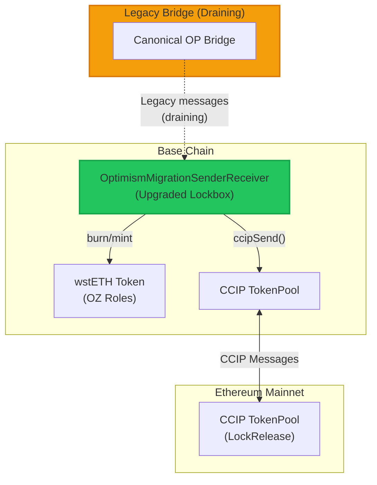
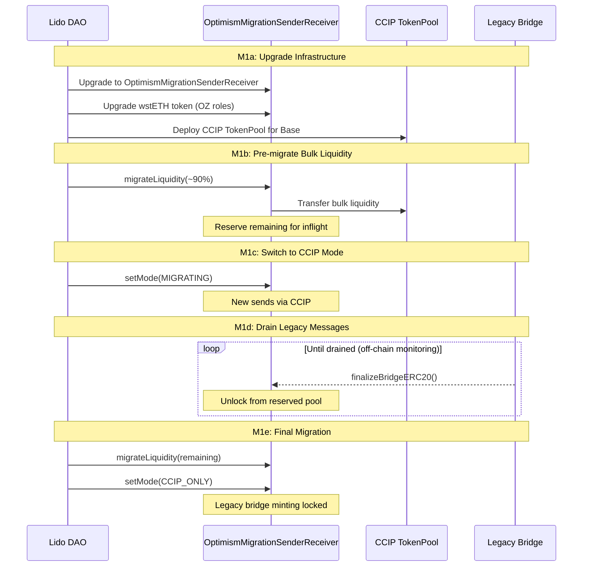

# Base Migration PRD: wstETH Legacy Bridge to CCIP

> Archived design basis, preserved 2026-10-30. Its reserve/drain and manager-era design is superseded by the [one-vote design](../../../targets/wsteth-base-migration-mainnet/docs/2026-10-26-upgrade-path.md) and the [current component README](../README.md). References to the original external document set below are historical; those documents are not included in this repository.

**Version**: 1.0
**Date**: 2026-01-09
**Related**: `CONTRACT_DEVELOPMENT_PRD_v4.md` (original document set) (core contract architecture)

---

## Executive Summary

This PRD covers the migration of Base wstETH from its legacy custom bridge to Chainlink CCIP. Unlike Stage 0 chains (which deploy fresh CCIP pools), Base requires a gradual migration that:
- Maintains service continuity during transition
- Protects inflight transactions from the legacy bridge
- Enables bulk liquidity migration with reserved funds for legacy draining
- Supports receiving legacy messages while sending via CCIP

**Contract Items Covered**: C7, C7-token, C7a, C7b, C7c
**Migration Items Covered**: M1a, M1b, M1c, M1d, M1e (Stage 1 Base)

---

## Architecture Overview



---

## Migration Phases

| Phase | State | Sending | Receiving | Duration |
|-------|-------|---------|-----------|----------|
| 1 | LEGACY | Canonical bridge | Legacy only | Pre-migration |
| 2 | MIGRATING | CCIP | Both (legacy + CCIP) | Days/weeks |
| 3 | CCIP_ONLY | CCIP | CCIP only | Steady state |

---

## C7: Upgrade Lockbox to OptimismMigrationSenderReceiver

**Owner**: Louis/Aphyla (CLL)
**Dependencies**: None
**Target Chain**: Base

### Description

Upgrade the current Base lockbox contract (proxy upgrade) to support both legacy and CCIP messaging.

### Technical Approach

- Upgrade the current Base lockbox contract (proxy upgrade)
- Maintain same user-facing interface (backwards compatible)
- Add CCIP sender/receiver capabilities:
  - Implement `ccipReceive()` for incoming CCIP messages from router
  - Implement `ccipSend()` for outgoing CCIP transfers
- Connect to CCIP Router and TokenPool
- Keep legacy receipt function (e.g., `finalizeBridgeERC20()`) for draining inflight messages

### BridgeMode States

```solidity
enum BridgeMode {
    LEGACY,           // Send: canonical bridge, Receive: legacy only
    MIGRATING,        // Send: ccipSend(), Receive: BOTH (legacy + CCIP, draining inflight)
    CCIP_ONLY         // Send: ccipSend(), Receive: CCIP only (legacy disabled)
}
```

### How Sending Works

- User calls same interface (e.g., `bridgeERC20To()`)
- **LEGACY mode**: Routes through canonical bridge (current behavior)
- **MIGRATING/CCIP_ONLY mode**: Internally calls `ccipSend()` to destination

### How Receiving Works

- **Legacy receipt**: Canonical bridge calls legacy function (e.g., `finalizeBridgeERC20()`)
  - Available in LEGACY and MIGRATING modes
  - Disabled in CCIP_ONLY mode (after drain complete)
- **CCIP receipt**: Router calls `ccipReceive()`
  - Available in MIGRATING and CCIP_ONLY modes

### Success Criteria

- [ ] Maintains exact same user-facing interface during transition
- [ ] No service interruption during upgrade
- [ ] Can process both legacy and CCIP messages simultaneously
- [ ] All funds accounted for across both bridges

---

## C7-token: Upgrade wstETH Token to OZ Roles-Based BurnMint

**Owner**: Louis/Aphyla (CLL)
**Dependencies**: C7
**Target Chain**: Base

### Description

Upgrade Base wstETH token contract to use OpenZeppelin AccessControl for mint/burn permissions.

### Technical Approach

- Upgrade Base wstETH token contract (proxy upgrade)
- Add OpenZeppelin AccessControl:
  - `MINTER_ROLE`: Can mint tokens (granted to CCIP TokenPool)
  - `BURNER_ROLE`: Can burn tokens (granted to CCIP TokenPool)
- Legacy lockbox minting is disabled via mode change (when `CCIP_ONLY` mode is set, `bridgeMint()` reverts)
- Maintain existing token functionality

### Success Criteria

- [ ] CCIP TokenPool can mint and burn via roles
- [ ] Legacy lockbox minting locked when mode set to CCIP_ONLY (`bridgeMint()` reverts)
- [ ] Token transfers unaffected during upgrade
- [ ] No change to user balances

---

## C7a: Liquidity Migration Function

**Owner**: Louis/Aphyla (CLL)
**Dependencies**: C7
**Target Chain**: Base

### Description

Add function to migrate locked liquidity from legacy bridge reserve to CCIP TokenPool.

### Technical Approach

- Add `migrateLiquidity(uint256 amount)` function to lockbox
- Transfers locked wstETH from legacy bridge reserve to CCIP TokenPool
- **Current implementation**: Migrates bulk of liquidity initially (~90%), reserves remainder for inflight legacy messages, then migrates remainder after drain period completes
- The exact ratio depends on estimated inflight messages at migration time

### Safety Mechanisms

- Total liquidity accounting: `legacyReserve + ccipReserve == totalLocked`
- Admin-only function (requires DAO governance via PoolOperationManager)
- Reserved liquidity maintained for inflight legacy messages (monitored off-chain)

### Success Criteria

- [ ] Migrates liquidity without service interruption
- [ ] All funds accounted for at every step
- [ ] Emits events for each migration chunk
- [ ] Can be executed over days or weeks

---

## C7b: Legacy Message Reception During CCIP Mode

**Owner**: Louis/Aphyla (CLL)
**Dependencies**: C7
**Target Chain**: Base

### Description

After switching to CCIP sender mode, maintain legacy receiver to drain inflight messages.

### Technical Approach

- After switching to CCIP sender mode, maintain legacy receiver
- **Off-chain monitoring**: Inflight legacy messages are tracked off-chain, not on-chain
  - Some messages may have been inflight for extended periods
- Reserved liquidity is maintained on the bridge to handle any legacy messages that eventually execute
- When legacy message arrives:
  - Unlock from reserved pool (not from CCIP pool)
  - Emit event for monitoring

### Draining Process

1. Switch to CCIP sending (users send via CCIP going forward)
2. Reserve sufficient liquidity for estimated inflight legacy messages
3. Monitor legacy message arrival off-chain
4. After no legacy messages for N days, mark drain complete
5. Proceed to C7c
6. **Alternative**: If acceptable to lose very old inflight messages, switch mode to CCIP_ONLY earlier and migrate full remaining balance

### Success Criteria

- [ ] All inflight legacy messages processed successfully
- [ ] No user funds lost during transition
- [ ] Clear monitoring of drain progress
- [ ] Events enable verification of completion

---

## C7c: Final Migration to CCIP-Only Mode

**Owner**: Louis/Aphyla (CLL)
**Dependencies**: C7, C7a, C7b
**Target Chain**: Base

### Description

Complete transition to pure CCIP mode once legacy messages are drained.

### Technical Approach

- Once legacy messages are drained (confirmed via off-chain monitoring):
  - Migrate remaining legacy reserve to CCIP TokenPool
  - Set mode to `CCIP_ONLY`
  - Legacy bridge functions are automatically disabled (e.g., `bridgeMint()` reverts in CCIP_ONLY mode)
- Lockbox becomes pure CCIP sender/receiver
- **Note**: No explicit role revocation is needed; the mode change itself locks legacy bridge minting

### Final State

- All liquidity in CCIP TokenPool
- All messages via CCIP Router
- Legacy bridge completely disabled
- Full per-lane rate limiting and dual token buckets active

### Success Criteria

- [ ] 100% of liquidity migrated to CCIP
- [ ] Legacy bridge non-functional (reverts on calls)
- [ ] CCIP transfers working normally
- [ ] Total supply unchanged throughout migration

---

## Migration Sequence (M1a-M1e)



### M1a: Upgrade Base Migration Infrastructure

**Owner**: Lido
**Dependencies**: D8, M0a
**Target Chain**: Base

- Upgrade existing Base lockbox to OptimismMigrationSenderReceiver
- Upgrade Base wstETH token to OZ roles-based BurnMint
- Configure Base <-> Ethereum lanes

### M1b: Pre-migrate Bulk Liquidity

**Owner**: Lido
**Dependencies**: M1a
**Target Chain**: Base

- Migrate bulk of locked tokens (~90%) to CCIP TokenPool in a single transaction
- Leave reserve for existing inflight messages (exact amount based on off-chain estimation)
- **IMPORTANT**: Once liquidity migration begins, legacy sending is disabled in BOTH directions (L1→L2 and L2→L1). The legacy bridge can only receive inflight messages, not create new ones.

### M1c + CF5-base: Switch to CCIP Mode and Activate (Atomic)

**Owner**: CLL/Lido
**Dependencies**: M1b, CF1, CF2, O1a, BSC signoff
**Target Chain**: Base

- Prepare OptimismMigrationSenderReceiver to use CCIP for transfers
- Register Base pool in TokenAdminRegistry (CF5-base)
- **These steps execute atomically for no-downtime failover**
- Requires BSC approval before execution
- Can still receive/deliver old inflight legacy messages

### M1d: Monitor and Drain Legacy Messages

**Owner**: CLL/Lido
**Dependencies**: M1c
**Target Chain**: Base

- After CCIP activation, monitor remaining legacy bridge messages via off-chain tooling
- Reserved liquidity on lockbox handles any legacy drains that execute
- Wait until inflight queue is empty (or decide to proceed to CCIP_ONLY accepting potential loss of very old inflight messages)
- **Drain period: ~3 weeks** (includes 7-day OP Stack challenge window + buffer for slow executions)

### M1e: Final Liquidity Migration

**Owner**: CLL/Lido
**Dependencies**: M1d
**Target Chain**: Base

- Migrate remaining reserved liquidity to TokenPool
- Disable legacy bridge reception completely
- OptimismMigrationSenderReceiver is now pure CCIP sender/receiver

---

## Testnet Rehearsal (TM1a-TM1e)

All Base migration steps are rehearsed on testnet first during the testing window:

| Testnet ID | Mirrors | Description |
|------------|---------|-------------|
| TM1a | M1a | Upgrade Base infrastructure on testnet |
| TM1b | M1b | Pre-migrate liquidity on testnet |
| TM1c | M1c | Switch to CCIP mode on testnet |
| TM1d | M1d | Drain legacy messages on testnet |
| TM1e | M1e | Final migration on testnet |

See `DEPLOYMENT_PROCEDURES.md` (original document set) for testnet operations details.

---

## Implementation Checklist

### C7 Series
- [ ] C7: Upgrade lockbox to OptimismMigrationSenderReceiver
- [ ] C7-token: Upgrade wstETH to OZ roles BurnMint
- [ ] C7a: Liquidity migration function
- [ ] C7b: Legacy message reception during CCIP mode
- [ ] C7c: Final migration to CCIP-only mode

### Migration Steps (Stage 1 Base)
- [ ] M1a: Upgrade Base infrastructure
- [ ] M1b: Pre-migrate bulk liquidity
- [ ] M1c: Switch to CCIP mode
- [ ] M1d: Drain legacy messages
- [ ] M1e: Final migration

---

## Related Documents

- `PRD.md` (original document set) - Overarching PRD linking all documentation
- `CONTRACT_DEVELOPMENT_PRD_v4.md` (original document set) - Core contract architecture (QuorumTokenPool, PoolOperationManager)
- `DEPLOYMENT_PROCEDURES.md` (original document set) - Deployment scripts and procedures
- `work_items.csv` (original document set) - Master task tracker

**Operations Documentation**: O1-O4 (monitoring, emergency procedures) will be documented during testnet rollout.
