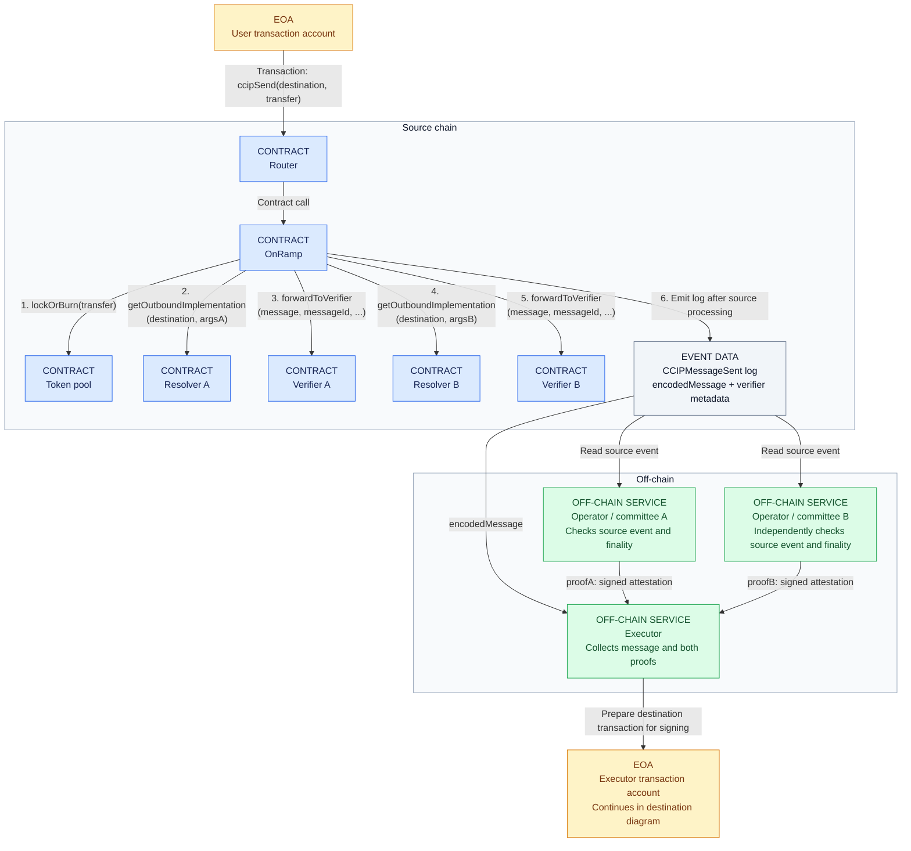
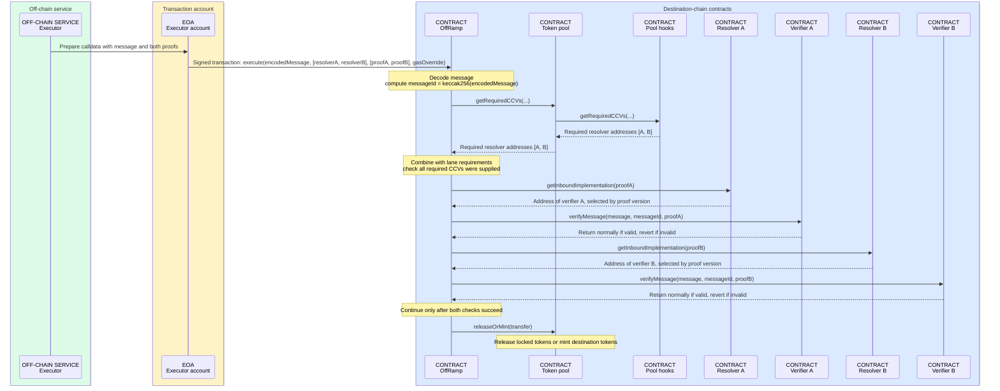

# Two-CCV verification: data flow and production gap

Operational companion: [multichain setup and CCV onboarding](MULTICHAIN-OPERATIONS.md)
describes the configurable spoke topology, desired CCV policy, generated governance
calls and the information to obtain from Nethermind. Dummy remains an intentional
bootstrap choice; future provider support is not claimed by that configuration.

This explanation describes the CCIP 2.0 contracts and fork scenarios inspected in
the local repository on 2026-10-08. Deployment statements refer to the repository's
configuration and records, not a fresh on-chain state check. A and B below denote
two independent verification systems; they do not name selected production providers.

**Proofs come from off-chain verifier operators. Resolvers tell the OffRamp which
on-chain contract should check each proof.** With both CCVs required, neither one
alone can authorize delivery. Either verifier being unavailable can delay delivery.

The diagrams label every participant by type. Colors identify the same types in
both diagrams (node fills in the flowchart, participant groups in the sequence):

| Color | Type | Meaning |
| --- | --- | --- |
| Blue | CONTRACT | Code deployed on the indicated blockchain |
| Green | OFF-CHAIN SERVICE | Software or a committee of operators running outside the blockchain |
| Amber | EOA | Externally owned account used to sign and submit a transaction in this example |
| Gray | EVENT DATA | An on-chain log read by off-chain services, not an executing actor |

EOAs illustrate a direct transaction path, not a protocol requirement: users can
use smart wallets and execution can be routed through a contract. The executor
service and its transaction-submitting account are distinct objects. Committee
signers produce attestations off-chain and need not submit individual transactions.

## 1. Source transaction and off-chain proof production



Steps 1–6 execute sequentially within one source transaction, with A before B
in the illustrated verifier list. Off-chain operators A and B can work independently.

The source OnRamp calls each resolver's
`getOutboundImplementation(destChainSelector, extraArgs)`, then calls the returned
verifier's `forwardToVerifier(...)`. For `CommitteeVerifier`, the returned metadata
is its version tag; it is not the later off-chain signature proof. Return arrows
are omitted from this flowchart: each resolver returns its verifier's address to
the OnRamp, and each verifier returns its metadata to the OnRamp.

The operators observe the source event, apply their verification/finality policy,
and produce attestations. The executor obtains these attestations and submits the
destination transaction. The diagrams omit fee handling and other transfer checks
to focus on verification.

## 2. Destination contract calls

The executor service prepares one encoded message, an array of destination resolver
addresses, and a matching array of proof blobs. Its transaction account signs and
submits the call to the destination OffRamp. Source and destination resolver
addresses need not be the same. Every blue-group participant below is a separate
destination-chain contract in the illustrated production layout.



The resolver does not generate a proof or forward it to the verifier. It returns
an implementation address; the **OffRamp calls that verifier directly**.
`VersionedVerifierResolver` selects the inbound implementation using the first
four bytes of the submitted proof. One resolver selects one implementation for
that proof; it does not fan out to two verifiers.

For the token-only transfer illustrated here, the required set combines the pool's
declaration with lane-mandated CCVs. Defaults enter when the configuration requests
them through an `address(0)` entry. Using CCIP transport alone does not establish
that Chainlink's verifier is an additional required check. If the lane mandates
additional CCVs, the executor must supply those too.

Missing a required CCV or failing verification prevents this delivery's mint or
release. In the tested missing-CCV case, the outer `execute` records `FAILURE`;
a submitted transaction alone therefore does not establish successful delivery.

## 3. What a cryptographic proof contains

The installed CCIP dependency includes `CommitteeVerifier`, which provides a
concrete signature-based example:

```text
messageId     = keccak256(encodedMessage)
signed digest = keccak256(versionTag || messageId)
proof         = versionTag || signatureLength || signatures
```

Here `versionTag` is four bytes and `signatureLength` is two bytes. The verifier
checks the version and validates signatures against the signer set and threshold
configured for the source chain. The message hash binds the attestation to the
encoded transfer, including its source/destination context.

The two levels of quorum are distinct: each verifier may require several committee
signatures internally, while the OffRamp requires both verifier systems A and B.
Two deployed contracts with the same controlling signer set do not establish
independent verification. `CommitteeVerifier` explicitly documents the need for
distinct signer sets across instances and recommends distinct version tags as
additional separation.

This implementation already exists in the dependency. The placeholder setup does
not establish which production implementations or operators will be selected.

## 4. What the current deployment and tests actually do

The fresh-deployment configuration puts two resolvers in each pool hook's required
inbound and outbound sets: our resolver pointing to `DummyMessageIdVerifier`, and
the explicit Chainlink resolver. This applies to both directions of Sepolia–Base
Sepolia and Sepolia–Mantle Sepolia. The owned post-configuration step verifies
Chainlink's pinned implementation mappings and reads back the complete hooks table.

The `RealCcvLane` fork tests first assert that initial policy. The negative tests
retain the actual Chainlink requirement and check that a dummy proof alone cannot
mint or release tokens on either end. For positive delivery tests, the harness
replaces the Chainlink requirement with a test-local `MockCCV` through governance:
the fork cannot obtain genuine Chainlink attestations for its local messages.

In the two-CCV test, substitute these into the destination diagram:

| Slot | Resolver returns | Submitted proof | Actual verification |
| --- | --- | --- | --- |
| A | `DummyMessageIdVerifier` | `0xdecafbad || messageId` | Checks length, prefix and matching ID; no cryptographic authentication of the source event |
| B | `MockCCV` itself | Empty bytes | Accepts everything |

The dummy also retains caller/RMN checks; those do not turn its constructible
message-ID blob into an authenticated source-event attestation. The mock combines
resolver and verifier interfaces in one contract and returns its own address.

The tests supply the proof data and invoke the real OffRamp directly. They exercise
the real CCIP 2.0 enforcement path: both configured CCVs permit delivery; omitting
one prevents minting. They demonstrate required-set enforcement, not independent
cryptographic verification. The second mock is test-local, not part of the
documented public pool configuration.

## 5. Concrete production gap

1. **Deploy and configure authenticating verifier implementations.** Each required
   path must verify a real attestation, with the corresponding trust configuration
   such as authorized signers and a signature threshold. Existing implementations
   may be usable; this does not inherently require writing a new OffRamp.
2. **Configure each resolver's inbound and outbound mappings.** Each accepted
   proof version must resolve to an authenticating implementation. Leaving an
   accepted version mapped to the dummy would let a submitter select that
   non-authenticating path. Version retirement and any in-flight migration require
   an explicit rollout policy.
3. **Preserve both real verifier requirements in the hooks, in both directions.**
   The initial Chainlink requirement stays. If Nethermind supplies a compatible
   implementation behind our resolver, only its dispatch mappings need changing;
   if it supplies its own resolver, replace the local resolver entry in the hooks.
   The test demonstrates the governance call:
   `timelock.bypasserExecuteBatch -> hooks.applyCCVConfigUpdates`. The production configuration
   must use the intended addresses and account for lane-mandated requirements.
4. **Operate the off-chain services.** Independent operators must observe source
   events and publish attestations; an executor must retrieve and submit them.
   Fork tests currently supply these inputs themselves.

Adding one real verifier alongside the dummy gives only one meaningful
authentication check. The resolver interfaces, verifier-call interface and
OffRamp's required-set enforcement already exist. Production still needs real
verifier paths, their deployment/configuration, independent operations and
validation of invalid proofs, outages and recovery.

## Source references

Repository-owned sources:

- [DummyMessageIdVerifier](../../../components/ccip/chains/evm/contracts/lido-hvmv/ccvs/DummyMessageIdVerifier.sol): `verifyMessage`.
- [MockCCV](../../../targets/wsteth-ccip-sepolia-mantle-dev/test/mocks/MockCCV.sol): resolver methods and empty `verifyMessage`.
- [RealCcvLane](../../../targets/wsteth-ccip-sepolia-mantle-dev/test/scenario/RealCcvLane.t.sol): `_govEnable2of2`, `_verifierResults`, and delivery scenarios.
- [Deployment configuration](../../../components/ccip/chains/evm/contracts/lido-hvmv/script/deployment/2_Configure.s.sol): hook CCV arrays and `_configureCCVStack`.
- [Multichain operations](MULTICHAIN-OPERATIONS.md#ccv-policy-and-generated-governance-calls): current required-set policy, verification and deployment scope.

Installed dependency sources below require the CCIP node dependencies to be present:

- [OnRamp](../../../components/ccip/chains/evm/node_modules/@chainlink/contracts-ccip/contracts/onRamp/OnRamp.sol): outbound resolution, `forwardToVerifier`, `CCIPMessageSent`.
- [OffRamp](../../../components/ccip/chains/evm/node_modules/@chainlink/contracts-ccip/contracts/offRamp/OffRamp.sol): `execute`, `executeSingleMessage`, `_getCCVsForMessage`, `_ensureCCVQuorumIsReached`.
- [VersionedVerifierResolver](../../../components/ccip/chains/evm/node_modules/@chainlink/contracts-ccip/contracts/ccvs/VersionedVerifierResolver.sol): inbound version and outbound destination mappings.
- [CommitteeVerifier](../../../components/ccip/chains/evm/node_modules/@chainlink/contracts-ccip/contracts/ccvs/CommitteeVerifier.sol): proof encoding, signed digest and instance-separation notes.
- [SignatureQuorumValidator](../../../components/ccip/chains/evm/node_modules/@chainlink/contracts-ccip/contracts/ccvs/components/SignatureQuorumValidator.sol): signer membership and signature threshold validation.
